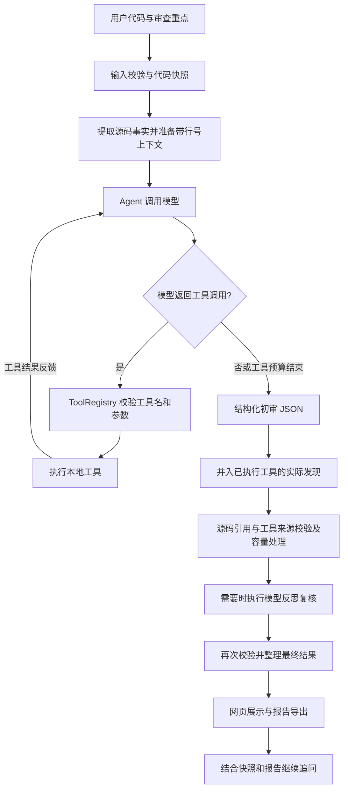
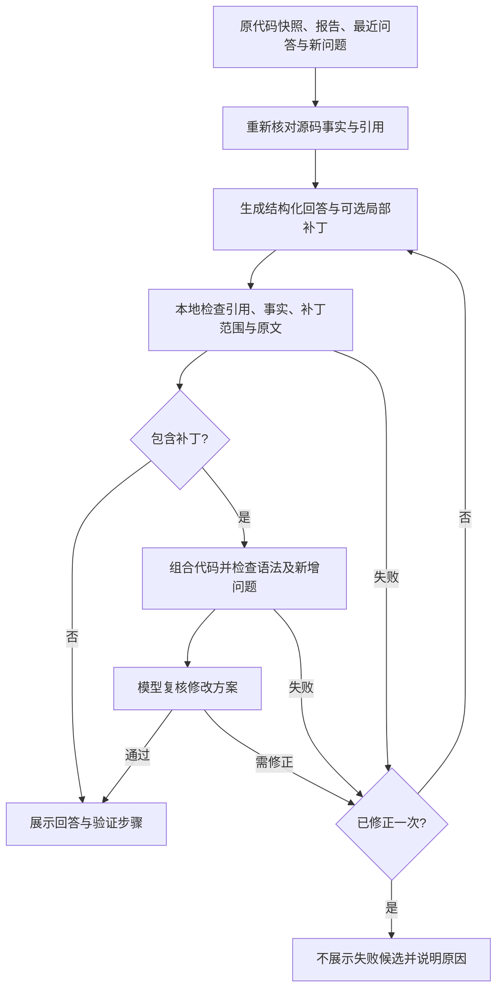

# CodeLens 代码审查 Agent

CodeLens 是面向 Python / C++ 单文件的代码审查 Agent，使用 Python + Streamlit 构建，支持 DeepSeek API 和无需密钥的离线规则演示。它将模型分析、本地工具、源码证据校验和反思复核结合起来，输出可定位、带触发条件和修改建议的审查报告。

项目用于软件工程课程实践，覆盖代码输入、模型决策、工具执行、结果反馈、报告输出和后续追问的完整流程。核心目标是让读者能够核对每条意见的依据，并区分静态规则诊断、模型复核意见和仍需补充上下文的假设。

**项目仓库：[KADG777/CodeLens](https://github.com/KADG777/CodeLens)**

## 阅读导航

- [主要功能与演示](#主要功能与演示)
- [Agent 架构与工作流程](#agent-架构与工作流程)
- [模块职责](#模块职责)
- [工具与语言支持](#工具与语言支持)
- [证据校验与报告设计](#证据校验与报告设计)
- [追问记忆与修改建议](#追问记忆与修改建议)
- [技术选型](#技术选型)
- [Windows 首次运行](#windows-首次运行)
- [使用](#使用)
- [项目目录](#项目目录)
- [自动化测试与评估](#自动化测试与评估)
- [适用范围与后续方向](#适用范围与后续方向)

## 主要功能与演示

- **代码输入：** 支持编辑区粘贴、文件上传和内置示例；按文件后缀识别 Python / C++，限制单文件最多 800 行、48 KB（UTF-8）。
- **工具辅助审查：** 模型可以选择结构解析、静态检查和受限计算工具，并根据工具反馈继续分析。
- **反思复核：** 对通过定位的高、中优先级候选，以及存在证据链缺口的部分低优先级候选进行复核。
- **证据展示：** 展示问题位置、原代码片段、触发条件、修改建议和依据状态；可展开校验记录、执行事件与检查限制。
- **继续追问：** 结合原代码、报告和最近问答解释问题，提供经过校验的局部修改建议。
- **报告导出：** 支持 Markdown 和 JSON，记录源码指纹、工具状态、复核结果、分阶段耗时及 token 用量。
- **离线演示：** 不调用模型 API，直接使用本地规则，可演示 Python / C++ 的输入、检查和报告流程。

演示录屏：[GitHub Release 视频下载](https://github.com/KADG777/CodeLens/releases/tag/demo-20261011)。打开发布页，在 Assets 中下载展示视频；实际展示结果对应录制时的代码、输入和运行配置。原视频作为附件提供，保持录屏画面和音频内容。

快速体验可选择 `examples/buggy_order.py` 或 `examples/buggy_order.cpp`，先用离线模式查看规则诊断，再用 API 模式体验模型分析和继续追问。`clean_order.py` / `clean_order.cpp` 用于对照检查；无报告项只表示本次检查没有保留候选。

## Agent 架构与工作流程

系统由一个 `ReviewAgent` 编排审查流程。模型提供分析和工具选择能力；程序掌握工具执行、参数校验、预算控制和报告整理。初审与反思复核使用同一模型，通过不同提示词承担不同任务。



一次完整审查包括以下阶段：

1. **输入与快照：** 检查文件类型、编码、大小、行数和审查目标，规范换行，生成源码指纹。后续行号、展示片段和追问都对应这一快照。
2. **准备上下文：** 提供完整带行号源码、语言、审查重点，以及本地受限分析提取的 `semantic_facts`。
3. **模型选择工具：** 模型返回真实 `tool_calls`；程序按允许列表和 Pydantic schema 校验后执行，通过 `role=tool` 和对应的 `tool_call_id` 返回结果。
4. **反馈与初审：** 模型根据反馈追加取证或直接输出 `Draft` JSON。程序解析并校验结构；工具规划最多 4 轮、工具执行最多 8 次，达到预算后基于已有证据生成报告。
5. **补回与证据校验：** 合并本次已执行的静态工具发现与模型候选，避免模型漏写诊断；检查原样引用、位置、工具诊断身份、重复项和报告容量。
6. **反思复核：** 完整模式下，对需要复核的候选逐条返回支持、待确认或否决裁决；检查保护分支、反例、触发条件和未知上下文。程序再次校验证据和事实冲突。
7. **报告输出：** 按最终保留项和待确认项重建摘要，展示结果、限制和执行记录，支持导出及追问。

典型在线路径是“工具规划 → 工具反馈与初审 → 反思复核”，通常为 3 次模型调用。没有待复核候选时可以跳过复核；追加工具、格式修复或服务重试会增加开销，3 次不是固定上限。

### 审查策略

| 策略 | 工具反馈循环 | 模型反思复核 | 用途 |
|---|---|---|---|
| `direct` | 无 | 无 | 直接模型初审基线，仍保留输入和本地证据校验 |
| `tools` | 有 | 无 | 观察工具反馈对初审的作用 |
| `full` | 有 | 对符合条件的候选执行 | 完整审查工作流 |

网页通过“反思复核”选项选择 `tools` 或 `full`；命令行提供 `--strategy`。离线模式固定执行读取、结构解析和静态检查，不支持 `direct`，模型调用和 token 均为 0。

## 模块职责

| 模块 | 主要文件 | 职责 |
|---|---|---|
| 交互入口 | `app.py`、`review_agent/__main__.py` | 网页与命令行接收输入，调用共享 Agent，展示结果和导出报告 |
| 输入与配置 | `files.py`、`languages.py`、`config.py`、`models.py` | 文件解码、语言识别、接口配置、输入限制和统一数据结构 |
| Agent 调度 | `agent.py` | 管理工具循环、阶段切换、终止预算、反思复核和审查用量 |
| 模型接入 | `llm.py`、`prompts.py`、`demo.py` | `ChatModel` 接口、DeepSeek HTTP 客户端、阶段提示词和离线模式支持 |
| 工具执行 | `tools.py`、`cpp_tools.py` | 工具注册、参数校验、Python AST / Ruff 与 C++ Tree-sitter 检查 |
| 源码事实与计算 | `semantics.py` | 受限切片、形状广播、Keras 划分计算，以及有限源码模式的事实提取与冲突检查 |
| 诊断选择 | `selection.py` | 实际工具诊断的确定性排序、精确去重、数量限制与省略提示 |
| 证据校验 | `verification.py`、`claim_checks.py` | 工具发现补回、引用定位、规则来源、触发条件和多处证据校验，整理最终状态 |
| 后续追问 | `followup.py` | 基于快照、报告和历史生成回答或补丁，执行本地校验、方案复核及一次修正 |
| 报告导出 | `reporting.py` | 从报告和代码快照生成 Markdown；JSON 由统一数据结构序列化 |

其中 `models.py` 定义 `ReviewInput`、`Finding`、`Draft`、`AuditBatch`、`ReviewReport` 等 Pydantic 模型，供网页、Agent、导出和评估共同使用。模型生成的问题需要通过这些结构约束，依据状态由程序赋值。

## 工具与语言支持

| 工具 | 功能 | 实现方式与范围 |
|---|---|---|
| `parse_structure()` | 提取结构与解析诊断 | Python 使用 AST；C++ 使用 Tree-sitter，提取函数、类、命名空间与 include 文本 |
| `run_static_checks()` | 返回本地规则诊断 | Python 使用内置 AST 规则与 Ruff；C++ 使用语法树上的保守局部规则 |
| `calculate_slice(shape, slices)` | 计算基本切片的归一化边界、形状和空值 | 支持负索引、负步长和越界裁剪，只接受受限整数参数 |
| `check_broadcast(target_shape, source_shape)` | 判断给定形状是否兼容赋值广播 | 只计算形状，不分配数组 |
| `keras_split(samples, validation_split)` | 计算训练与验证索引范围 | 使用内置 Keras API 合同，结果附来源和适用范围 |

`read_source` 和 `check_semantics` 保留为本地兼容入口，当前不提供给在线模型，因为请求已包含完整带行号源码和提取事实。完成的无参工具不再重复提供；静态检查结果可复用，计算工具可以使用不同参数继续取证。

Python 本地规则包括可变默认参数、裸 `except`、静默忽略异常、字面量零除数和动态执行风险提示，Ruff 补充未定义名称等诊断。C++ 规则覆盖部分零除数、危险调用、条件赋值、异常忽略及相邻 `new` / `delete` 配对模式；不做完整类型和控制流分析。

工具不导入或执行被审查代码，不接受任意命令或文件路径。Ruff 以固定参数通过标准输入接收代码，禁用仓库配置与缓存，并设 12 秒超时；C++ 不需要编译器，不展开宏或读取 include 目标。

## 证据校验与报告设计

模型生成的候选依次接受程序校验和必要的模型复核，主要设计包括：

- **引用可定位：** 主引用和补充引用必须原样对应源码；注释、独立文档字符串和拼接片段不能充当运行故障证据。只有唯一匹配时才自动修正行号。
- **工具来源可核查：** `rule_id` 必须匹配本次实际诊断及其位置、证据和内容；不匹配时移除工具背书，避免把模型扩写当作工具结论。
- **触发条件明确：** 区分本文件可说明的输入与外部环境假设。筛选为空需引用过滤条件和结果使用点；训练/推理比较需分别引用两端代码。
- **事实与计算分开：** `semantic_facts` 来自支持的源码模式；`calculations` 的参数由模型选择，计算结果还需核对与源码的对应关系。
- **实际发现补回：** 已执行静态工具返回的诊断会并入候选。补回发生在复核之前，复核否决的诊断不会在报告末尾再次添加。
- **容量限制可见：** 工具通道按优先级排序后限制数量；合并后最多 30 条候选进入报告处理。省略数量及原因记录为限制、事件或 `truncated` 校验记录。
- **复核结构受约束：** 裁决必须覆盖全部待复核候选 ID，不能遗漏、重复或新增。初审输出预算为 3200 token，复核预算按候选数增长并受上限约束；格式错误最多再请求一次修复。

报告使用 `schema_version=5`，每条意见包含标题、优先级、类别、行号、解释、源码证据和建议，还可包含补充证据、触发条件及规则编号。

| 状态 | 含义 | 保存位置 |
|---|---|---|
| `static` | 已匹配本次实际静态工具诊断 | `findings` |
| `reviewed` | 通过证据校验且获得模型复核支持 | `findings` |
| `pending` | 未复核、复核不确定或依赖外部条件 | `pending_findings` |
| `withheld` | 特定证据约束未满足，暂不展示 | `verification_records` |
| `rejected` | 候选被否决 | `verification_records` |

优先级描述影响程度，依据状态描述支持来源。网页和 Markdown 合并展示问题与待确认建议，但逐条保留状态，数量包含待确认项。原样引用证明位置对应，静态规则和同模型复核均不构成运行测试或正确性证明。

报告同时记录语言、模式、模型、策略、源码指纹、检查状态、复核状态、限制、执行事件及分阶段耗时与 token。工具失败会标注检查覆盖不足；反思复核失败时保留可匹配的实际规则诊断，其余模型候选按证据情况待确认或暂不展示。

## 追问记忆与修改建议

一次审查维护模型消息和工具反馈。后续追问使用原代码快照、报告和最近四轮问答，不携带全部原始工具消息。新审查清空旧问答；代码或文件名变化后提示旧报告并要求重新审查。

追问可解释问题、分析触发输入、提出验证步骤，或生成最多三段局部补丁。每段补丁包含原快照行号、完整原文、替换内容和修改理由；程序检查范围、原文和重叠情况，在内存中组合后检查完整文件。



Python 补丁检查 AST 语法和新增 Ruff F821 未定义名称；C++ 补丁检查语法树，不编译。失败时最多修正一次，保留逐次校验状态，区分历史失败候选和最后一次结果。建议只展示，不自动写入文件。

对已识别的少量切片算例和 API 合同问题，可直接使用本地事实回答；其他解释通常一次模型调用，补丁通常需要生成与方案复核两次调用，修正会增加调用。会话记忆用于上下文衔接，源码事实仍需重新核对。

## 技术选型

| 技术 | 用途 | 选择理由 |
|---|---|---|
| Python | 核心实现、AST 分析与评估 | 便于组合工具并编写可复现测试 |
| Streamlit | 网页交互与会话状态 | 用较少界面代码实现输入、报告、追问和下载 |
| HTTPX | DeepSeek HTTP 接口 | 集中处理超时、重试、错误提示和用量 |
| Pydantic | 输入、参数与输出结构 | 统一数据格式并校验模型输出 |
| Ruff | Python 静态诊断 | 提供成熟的本地规则结果 |
| Tree-sitter C++ | C++ 结构与局部规则 | 无需安装编译器即可解析当前源码 |
| pytest、NumPy | 自动化测试与数值对照 | 验证协议、分流、修正流程和受限形状计算 |

Agent 循环直接实现于 `review_agent/agent.py`，没有引入大型 Agent 框架。当前范围较小，显式控制流程便于理解工具协议、检查预算并重放异常场景；更详细的设计说明见 [docs/DESIGN.md](docs/DESIGN.md)。

## Windows 首次运行

1. 先安装 Python 3.11 或 3.12，并勾选 Add Python to PATH。
2. 克隆仓库，或下载源码 ZIP 后完整解压，不要直接在压缩包内运行。
3. 在 CodeLens 仓库根目录双击 `install.cmd`，或打开 PowerShell 执行：

```powershell
powershell -NoProfile -ExecutionPolicy Bypass -File .\setup.ps1
```

首次安装需要网络。安装完成后双击 `start.cmd`，打开终端显示的本地地址（通常 http://127.0.0.1:8501）。若端口被占用，可执行：

```powershell
.\.venv\Scripts\python.exe -m streamlit run app.py --server.port 8502
```

也可手动安装：

```powershell
python -m venv .venv
.\.venv\Scripts\python.exe -m pip install -r requirements.txt
.\.venv\Scripts\python.exe -m streamlit run app.py
```

## 使用

- 不填密钥：选择离线演示，载入 Python 或 C++ 示例，开始审查。离线模式只运行本地规则。
- 使用模型：选择 DeepSeek API，在侧栏输入自己的 Key，并设置账户可用的模型名称；也可复制 `.env.example` 为 `.env` 后填写。当前模型接入和实测使用 DeepSeek。
- 密钥不会随本包提供。侧栏输入用于浏览器及服务端会话，不自动写入报告。
- 模型模式会将提交的代码及审查上下文发送到配置的 API。不要公开 `.env`。
- 问题与建议合并展示，但各条保留依据状态；模型复核不等于已运行代码或正确性证明。
- 继续追问支持局部修改建议：检查补丁影响的后续引用，并用组合后的代码复核。失败时最多修正一次；展开校验记录可区分历史候选与最后一次失败原因。建议不会自动应用到文件。
- 识别语言取决于文件后缀；支持单文件最多 800 行 / 48 KB。C++ 不需要安装编译器。

命令行也可调用同一 Agent，例如：

```powershell
.\.venv\Scripts\python.exe -m review_agent examples/buggy_order.py --demo
.\.venv\Scripts\python.exe -m review_agent examples/buggy_order.cpp --demo
.\.venv\Scripts\python.exe -m review_agent examples/buggy_order.py --strategy full --format json --output reports/review.json
```

前两条为离线检查，最后一条需要在 `.env` 中配置自己的 API Key，会调用模型。`--focus` 可指定审查重点，`--format` 支持 `markdown` / `json`，`--output` 指定保存位置。

## 项目目录

```text
CodeLens/
├── app.py                    # Streamlit 网页入口
├── review_agent/             # 调度、模型、工具、证据、追问与报告
├── examples/                 # Python / C++ 问题与改进示例
├── tests/                    # 自动化回归测试
├── evals/                    # 合成评估输入与已交付的历史结果
├── docs/                     # 详细设计、验证指南与质量评估说明
├── record_demo.py            # 记录真实 API 的公开工具调用与报告
├── evaluate.py               # 主审评估
├── evaluate_followup.py      # 追问评估
├── score_evaluation.py       # 检查历史结果哈希并复算标注指标
├── benchmark_review.py       # 同输入、不同实现的速度对比
├── install.cmd / setup.ps1   # Windows 依赖安装
├── start.cmd                 # 启动网页
├── requirements*.txt         # 运行、开发依赖与原环境版本记录
├── .env.example              # 接口配置模板
├── .streamlit/               # 本地服务配置
└── MANIFEST.sha256.json      # 仓库交付文件 SHA-256 清单
```

展示视频通过上方 GitHub Release 提供下载，不增加源码仓库的克隆大小。

`requirements.txt` 是运行依赖，`requirements-dev.txt` 被 setup.ps1 使用并额外安装 pytest 和测试所需 NumPy；`requirements-lock.txt` 保留原开发环境版本供参考。
本仓库提供源码与文档；本地虚拟环境、密钥和日常运行生成的 `reports/` 不随 Git 提交，课程课件也不属于仓库内容。运行需要安装 Python 和依赖。

## 自动化测试与评估

在本仓库根目录运行：

```powershell
.\.venv\Scripts\python.exe -m pip install -r requirements-dev.txt
.\.venv\Scripts\python.exe -m pytest -q
.\.venv\Scripts\python.exe -m ruff check app.py evaluate.py evaluate_followup.py score_evaluation.py benchmark_review.py record_demo.py review_agent tests
.\.venv\Scripts\python.exe evaluate.py --demo --output reports/eval-demo.json
```

测试使用本地工具和模拟模型，不需要 API Key，也不会调用真实模型。覆盖 Python/C++ 规则、Agent 工具循环、证据校验、追问、网页、接口错误处理，以及静态发现补回和超过报告容量时的截断提示。通过测试说明这些场景的行为符合断言，不代表通用审查准确率。

真实 API 验证需要在本机 `.env` 中配置**自己的** Key 和可用模型名，运行以下命令会产生 API 用量，仅发送仓库内的合成代码：

```powershell
.\.venv\Scripts\python.exe record_demo.py --output reports/live-demo-current.json
.\.venv\Scripts\python.exe evaluate.py --cases evals/quality.json --strategy full --output reports/quality-current.json
.\.venv\Scripts\python.exe evaluate_followup.py --output reports/followup-current.json
```

`record_demo.py` 只发送内置的 Python/C++ 两份合成代码，记录公开工具调用、工具反馈、模型输出、复核和最终报告；本轮已完成的记录见 [submission-20261002.json](evals/results/submission-20261002.json)。更多评估样例也保留完整报告、耗时和 token；质量结论仍需逐条检查。[评估说明](docs/QUALITY_EVALUATION.md)区分 2026-09-28 历史开发结果和当前版本验证。`reports/` 与 `.env` 已忽略，不会因为运行评估而自动上传。不要把密钥写入源码或报告；也不要把本机 `.env` 加入 Git。

已交付的验证指南记录了 **2026-10-02 完整回归 245 项通过**及当时的真实 API 演示。这是对应日期和版本的记录；重新运行时应以本机结果为准，不能把历史测试数量或小规模合成用例结果作为当前通用准确率。

## 适用范围与后续方向

当前支持 Python / C++ 单文件的静态审查和受校验建议。复杂业务逻辑、动态行为、完整类型信息、跨文件依赖和真实环境效果仍需补充上下文及测试。C++ 的解析结果受宏、模板和条件编译影响，语法树诊断不能直接视作编译器结论。

源码事实提取、触发条件识别和自然语言约束只覆盖有限模式。初审和复核共享模型，仍可能重复误判；证据引用完整不代表推断必然成立。识别率、性能或修改效果需要独立实验，系统不能仅凭建议承诺提升。

后续可扩展 Git diff 审查、多文件上下文和更多规则；如加入自动修复或执行测试，需要设计独立的隔离执行环境与应用流程，并用相同标准重新评估质量和开销。

详细材料：

- [设计说明](docs/DESIGN.md)：工具协议、证据约束、容量处理和追问设计。
- [验证指南](docs/VALIDATION_GUIDE.md)：安装、离线回归、真实 API 演示及评估复跑。
- [质量评估](docs/QUALITY_EVALUATION.md)：历史与提交阶段的结果、失败案例和版本边界。
